  

  
  
  

 

## 👋 Hola, soy Hector Francisco del Castillo Vega

Licenciado en **Tecnologías de la Información en las Organizaciones** por la **Universidad Veracruzana**, con certificaciones de **Python** y **Ciberseguridad** de Santander.

Además de programar, administro empresas. Por eso no vendo tecnología por vender: construyo la herramienta exacta que un negocio necesita y la explico sin tecnicismos.

<table>
  <tr>
    <td width="33%" valign="top">
      <h3>🌐 Más clientes</h3>
      Páginas web rápidas, listas para Google y con botón directo a WhatsApp.
    </td>
    <td width="33%" valign="top">
      <h3>🧩 Orden total</h3>
      Sistemas a la medida para cobranza, clientes, contratos e inventarios.
    </td>
    <td width="33%" valign="top">
      <h3>⚙️ Cero trabajo repetido</h3>
      Recibos, recordatorios y reportes que se generan y se envían solos.
    </td>
  </tr>
</table>

 

## ⚡ Me encanta automatizar

 

## 📊 Resultados reales

 

## 🚀 Proyectos

| | Proyecto | Qué hace |
|:-:|---|---|
| 🏠 | **[Rentaly](https://hector-castillo-dev.vercel.app/proyecto.html?p=rentaly)** | Administración de rentas: recibos PDF, WhatsApp automático, contratos y portal de inquilinos |
| 🚚 | **[Multimodal Ortiz](https://hector-castillo-dev.vercel.app/proyecto.html?p=ortiz)** | Sitio con cotizador por servicio y panel administrativo para logística y comercio exterior |
| 🏡 | **[Representaciones Vega](https://hector-castillo-dev.vercel.app/proyecto.html?p=inmo)** | Sitio inmobiliario con propiedades, WhatsApp directo y campañas en Google Ads |
| 🐜 | **[Control de Plagas](https://hector-castillo-dev.vercel.app/proyecto.html?p=plagas)** | Del anuncio a WhatsApp en menos de 30 segundos, pensado para celular |
| 🐱 | **[P-loo](https://hector-castillo-dev.vercel.app/proyecto.html?p=ploo)** | IoT con RFID y ESP32, app PWA y notificaciones al celular |
| 🌎 | **[PayMyUni](https://hector-castillo-dev.vercel.app/proyecto.html?p=pay)** | Pago de colegiaturas en la red Stellar, confirmado en ~5 segundos |

> 🔒 Los sistemas de mis clientes son privados: muestro lo que hacen, nunca su código ni sus datos.

 

## 🛠️ Stack

  
   
  

  
  
  
  
  
  
  

 

  <b>¿Tu negocio tiene tareas que se repiten todos los días?</b> 
  Cuéntame tu idea y te mando una cotización sin costo.

  

